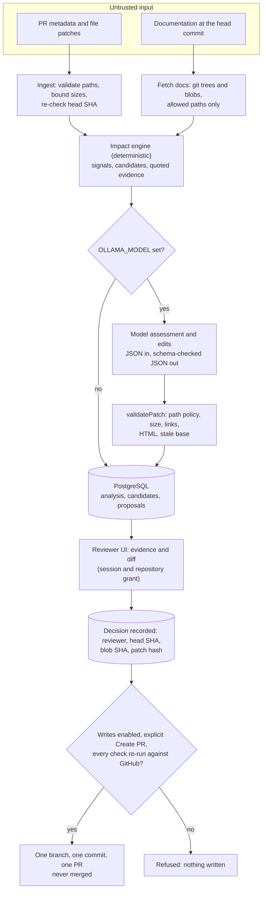
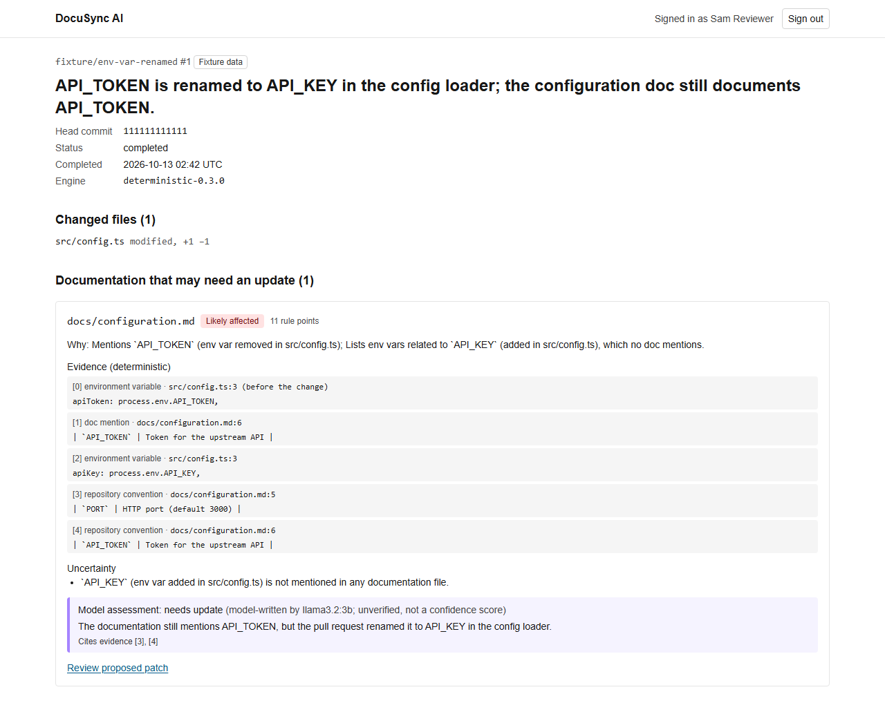
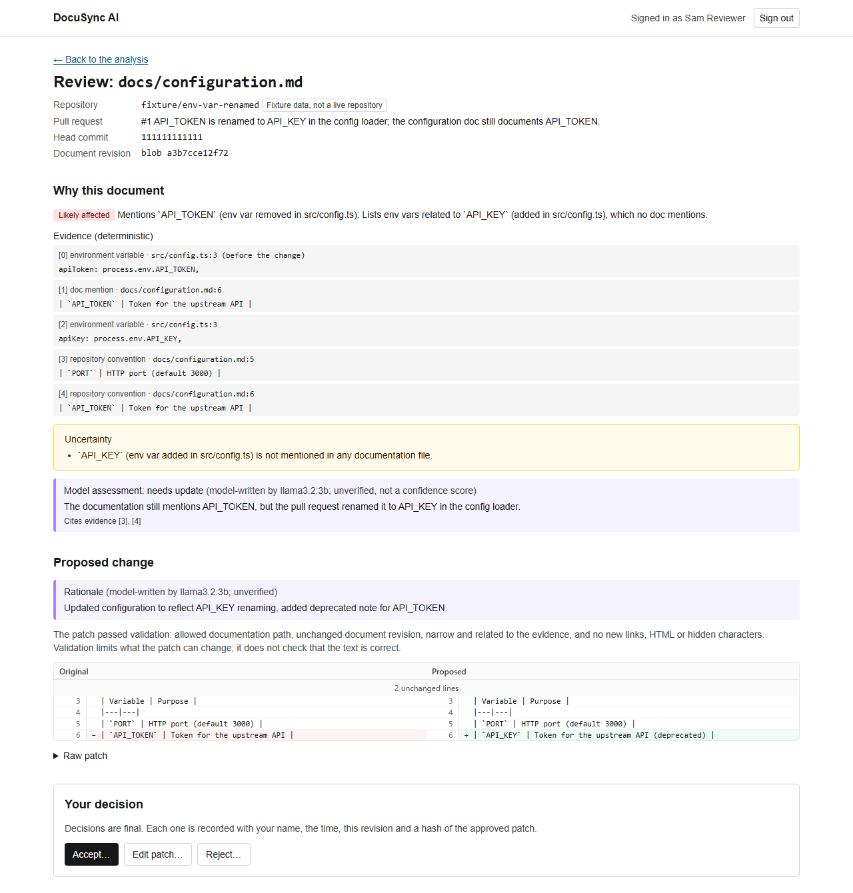
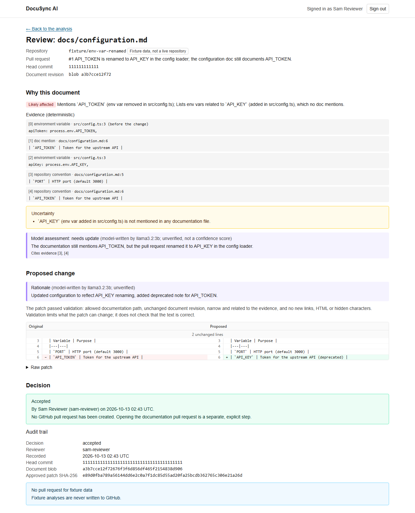

# DocuSync AI

A documentation maintenance assistant for GitHub pull requests. It flags the documentation a pull request may have made stale, shows the evidence, drafts a narrow patch, and lets a human accept, edit or reject it. Only after a recorded approval does it open a **separate** documentation pull request. It never merges anything.

**Status: beta**, for local and private-network use (D-016). It is not a hosted service, and nothing here claims production readiness. No license file is included yet.

[Setup](docs/setup.md) · [Architecture](docs/02-architecture.md) · [Security](docs/07-security.md) · [Testing and evaluation](docs/08-testing-and-evaluation.md) · [Development](docs/development.md) · [Decisions](docs/decisions.md) · [All docs](docs/INDEX.md)

## The problem

Documentation goes stale in pull requests that never touch it. A renamed environment variable, a removed script or a moved route leaves the README and the guides wrong, and reviewers rarely notice. Asking a language model "does this PR need doc changes?" is not enough: the answer is unverifiable, and a model that can also write to the repository is a risk.

## Who it is for

Maintainers and reviewers of repositories whose documentation lives in the repository (Markdown at the root or under `docs/`), who want help finding stale docs and drafting fixes without giving up control of what is merged.

## How it works

1. **Ingest** a pull request: metadata and file patches through the GitHub API, never by checking out or running its code.
2. **Find candidates deterministically.** A rule-based impact engine extracts signals from the diff (environment variables, exports, routes, package scripts, config keys, file paths and links) and matches them against the documentation. Every flagged document carries quoted evidence with file and line, and a stated reason. When evidence is weak it reports uncertainty instead of inventing a link.
3. **Optionally ask a local model** (Ollama) to assess each flagged document and propose `{find, replace}` edits. The model gets no tools or credentials and never chooses a file. The server renders the diff from the edits and validates it: allowed documentation path, size, no new links or raw HTML, no hidden characters, unchanged base revision.
4. **A reviewer decides.** Reviewers sign in with local accounts and see the evidence, the model's labelled-as-unverified assessment and a side-by-side diff. They accept, edit or reject. The decision is bound to the exact head commit, document blob and patch hash.
5. **Create the documentation PR** is a separate, explicit step. It is off by default and re-checks the approval and GitHub's current state before writing one branch, one commit and one PR, authored by the App and never merged.



Component-level diagram, module boundaries and data flow: [docs/02](docs/02-architecture.md).

## The review workflow

These screenshots are captured from the real UI by `npm run screenshots` (see [docs/11](docs/11-demo-script.md)). The data is a **labelled synthetic fixture** (`fixture/env-var-renamed`), analysed by the real engine with `llama3.2:3b` writing the assessment and patch. It is not a live repository.

**Analysis:** the flagged document with quoted evidence, the uncertainty note and the model assessment labelled as model-written and unverified.



**Review:** the proposed change as a side-by-side diff, with the validation statement and the Accept / Edit / Reject controls.



**Decision:** the recorded decision and its audit trail. Fixture data never offers the documentation-PR step.



Look closely at the diff: the model correctly renamed `API_TOKEN` to `API_KEY` but also added "(deprecated)" to the new row, which is wrong. The patch still passed validation, because validation limits *what a patch can change*, not whether its prose is true, and the reviewer accepted it for the capture. This is why a human decision is the control, not the validator or the model. The other screenshots are in [`docs/assets/screenshots/`](docs/assets/screenshots/).

## Example output

`npm run analyze -- --fixture env-var-renamed` runs only the deterministic engine, with no database, GitHub or model. Abridged output:

```json
{
  "engineVersion": "deterministic-0.3.0",
  "candidates": [
    {
      "docPath": "docs/configuration.md",
      "status": "likely_affected",
      "reason": "Mentions `API_TOKEN` (env var removed in src/config.ts); Lists env vars related to `API_KEY` (added in src/config.ts), which no doc mentions.",
      "evidence": [
        { "signal": "env_var", "sourcePath": "src/config.ts", "lineRange": { "start": 3, "end": 3 }, "side": "base", "excerpt": "apiToken: process.env.API_TOKEN," },
        { "signal": "explicit_reference", "sourcePath": "docs/configuration.md", "lineRange": { "start": 6, "end": 6 }, "side": "head", "excerpt": "| `API_TOKEN` | Token for the upstream API |" }
      ],
      "missingContext": ["`API_KEY` (env var added in src/config.ts) is not mentioned in any documentation file."],
      "rankPoints": 11,
      "rules": ["env_var_removed", "undocumented_env_var"]
    }
  ]
}
```

`rankPoints` are fixed rule points, not a probability or a confidence score.

## Stack and why

| Component | Used for | Why |
|---|---|---|
| Next.js 16 (App Router), React 19, TypeScript strict, Tailwind 4 | Review UI and HTTP endpoints | One app for the UI and the API (D-001); thin route handlers over a framework-free core |
| PostgreSQL via `pg`, plain SQL migrations | Analyses, proposals, reviewers, decisions, idempotency ledger | Explicit SQL and grants for a least-privilege app role, with no ORM (D-002, D-007) |
| Zod | Runtime validation | Webhook payloads, request bodies, environment, model output and stored state are all untrusted |
| Ollama behind a provider interface | Optional assessments and patch edits | Local-first: repository content stays on a private network, and the provider is replaceable (D-003) |
| GitHub App with Octokit | Webhooks, reading PRs and docs, opening docs PRs | Short-lived, per-repository installation tokens and least-privilege permissions (D-008, D-013) |
| Vitest, React Testing Library, Playwright (screenshots only) | Tests and captures | Unit, database, UI and opt-in live-model tests |
| Docker Compose and Caddy | Local Postgres and a reference private-network deployment | Reproducible local setup; TLS proxy that publishes only the webhook path |
| GitHub Actions | CI | Format check, lint, type check, tests, build, database tests |

**Not implemented:** vector search, embeddings and retrieval-augmented generation. Candidate selection uses diffs and deterministic references; embeddings would be considered only if evaluation showed a measurable benefit (D-005). There is also no background runner: webhooks only enqueue (D-009).

## Quick start

Requires Node.js 24 (`.nvmrc`) and Docker.

```bash
npm ci
cp .env.example .env.local        # placeholders only; never commit real values
docker compose up -d --wait postgres
npm run db:migrate
npm run analyze -- --fixture env-var-renamed   # deterministic analysis, no GitHub or model needed
npm run dev                       # http://localhost:3000, health at /api/health
```

[docs/setup.md](docs/setup.md) covers the reviewer UI walkthrough, the optional Ollama model, the GitHub App and a test webhook. Commands, verification and conventions: [docs/development.md](docs/development.md). The reference Docker deployment and operations: [docs/10](docs/10-deployment-and-operations.md).

## Testing and evaluation

`npm test` (unit and component tests) needs no database, GitHub or model; `npm run test:db` needs Postgres; `npm run test:ollama` is opt-in. GitHub is faked at the `fetch` level in tests. CI runs on every push to `main` and every pull request (`.github/workflows/ci.yml`); check the repository's Actions tab for current results.

Evaluation numbers, measured on 2026-10-12 with commands in this repository. **They come from small synthetic fixtures written by the project's author and are not estimates of real-world performance.**

| Measure | Result | Source |
|---|---|---|
| Impact flagging, all 35 scenarios (deterministic) | precision 90.5% (19/21), recall 82.6% (19/23) | [`impact-baseline.md`](docs/evaluation/impact-baseline.md) |
| Impact flagging, held-out `impact-v3` (14 scenarios, labelled before any run) | precision 87.5% (7/8), recall 70.0% (7/10) | same; label hash in [docs/08](docs/08-testing-and-evaluation.md) |
| Model-assisted flagging (`llama3.2:3b`) | identical to deterministic: the model demoted nothing | [`llm-assisted.md`](docs/evaluation/llm-assisted.md) |
| Patches (`llama3.2:3b`) | 20 requested, 14 passed validation, 6 rejected; 41 model calls, median 2.9 s, p95 7.8 s | same |
| Engine latency | median 0.06 ms, p95 0.18 ms, 0 failures in 700 runs (one laptop) | [`impact-latency.md`](docs/evaluation/impact-latency.md) |

## Security summary

GitHub writes are off by default and need an explicit, server-recorded human approval. Pull-request code is never executed, and everything read from GitHub, plus the model's output, is treated as untrusted. In brief:

- Webhook HMAC verified over the raw body, installation allowlist, body and diff size limits.
- Patch targets limited to Markdown at the repository root or under `docs/`; links, raw HTML and hidden characters in proposals are rejected.
- Local reviewer accounts with per-repository grants, `SameSite=Strict` sessions, rate limits and a same-origin check.
- The write path mints a per-operation, single-repository token and passes every request through a two-layer allowlist; it has no merge or delete capability.
- The app's database role cannot alter its own audit trail, and `npm run db:check-grants` verifies that.

The full threat model, controls and the tests that evidence them: [docs/07](docs/07-security.md).

## Known limitations

- **No runner:** webhooks only enqueue (D-009). Live analyses are started from the CLI.
- **GitHub writes ran live once** (2026-10-15, a private sandbox repository, no ruleset, one PR; [docs/10](docs/10-deployment-and-operations.md)). Everything else is tested against a fake GitHub. Set up the rulesets in docs/10 before enabling writes for real.
- **Deterministic blind spots:** behaviour-only changes, CLI option names, Dockerfiles and other unparsed languages, newly added endpoints that docs don't mention yet, and generic words that collide with exported names.
- **The model can only demote flagged docs.** Its prose can be wrong even when the patch validates, so human review is required.
- **Single-instance assumptions:** decision and create-PR rate limits are in-process, and no per-IP limiter ships. The reviewer UI must stay on a private network.
- **Accepted risks:** trust in the app database role (D-013) and an inline-script CSP (D-012).
- **Reference deployment:** verified locally only, not on a hosted environment. The app does not assert its database role at startup, Ollama has no authentication of its own (it shares an internal network with the app only), and the Postgres and Ollama containers are not read-only or capability-dropped.
- **Not built:** MFA, signed decisions and decision expiry, vector search.
- **Future scope** (not started): a larger Ollama model and a re-run of the held-out evaluation, a ruleset-protected live write run and a hosted deployment, a shared rate limiter, and the hardening items above.

## Documentation

See [docs/INDEX.md](docs/INDEX.md). The numbered files are the design documents: requirements, architecture, data model, API contracts, impact engine, LLM and patches, security, testing and evaluation, UI, deployment and operations, demo, and the GitHub write workflow.

## License

No license file has been added to this repository yet.
