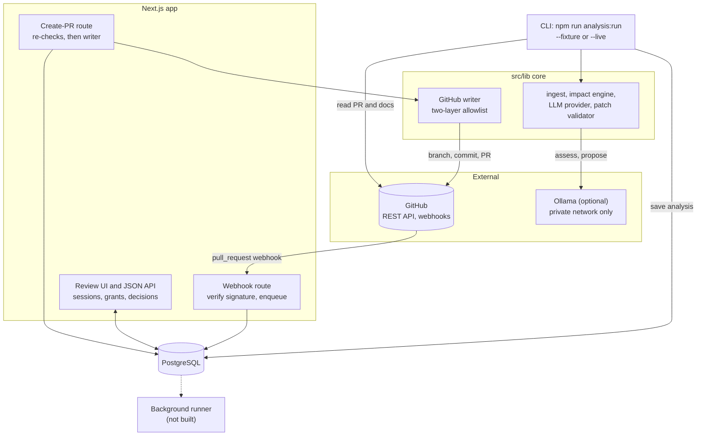
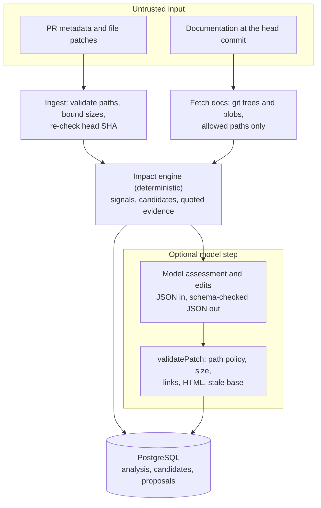
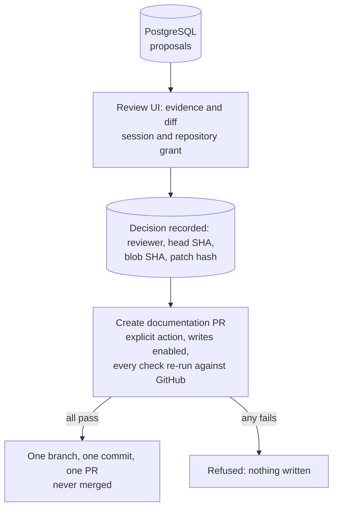

# Architecture

DocuSync AI is one Next.js application (App Router) with a framework-free core under `src/lib/`. It analyses pull requests, flags documentation that may need updating with deterministic evidence, optionally asks a local Ollama model for an assessment and a patch, stores the result for human review, and, only after a recorded approval, opens a separate documentation pull request.

## System overview

Who talks to whom. Solid edges exist today; the dashed edge is not built.

- **Webhooks only enqueue (D-009).** There is no runner, so live analyses come from the CLI (`analysis:run --live`).
- **Writes are off by default** and go only through the writer (docs/13).
- **The reference deployment** (docs/10) puts Postgres and Ollama on an internal network behind a TLS proxy.

## Pipeline and trust boundaries

Everything read from GitHub is attacker-controllable, and so is model output. Model output is schema-checked and validated before a person sees it; a person, not the model, approves.

**Analysis** (CLI, `src/lib/ingest.ts`, `impact-engine/`, `assist/`, `patches/`):

**Review and write** (review UI, `src/lib/review/`, `github/writer.ts`):

The model step runs only when `OLLAMA_MODEL` is set. Without it the analysis stores the deterministic result and no proposals, so there is nothing to review or write.

## Data flow

1. Verify the webhook signature over the raw request body.
2. Record an idempotency key and enqueue the analysis (the webhook never fetches from GitHub or runs a model).
3. Fetch bounded metadata and diffs with least-privilege credentials (CLI).
4. Parse changed files and extract deterministic evidence.
5. Select candidate documents and keep reasons and evidence references.
6. Optionally ask the configured model for an assessment and patch edits.
7. Validate all model output against schemas and patch policy.
8. Persist proposals for human review.
9. On explicit approval, re-check authorization and the source revision before any GitHub write.
10. Create a new documentation branch and pull request; never merge automatically.

## Module boundaries

These concepts are independently testable:
- `src/lib/github/`: GitHub adapter (webhook verification and handler, readers, document fetcher, writer).
- `src/lib/diff-analyzer/`: path validation and hunk parsing into a `PullRequestSnapshot`.
- `src/lib/impact-engine/`: candidate selection, ranking, evidence, and the evaluation harness.
- `src/lib/llm/`: provider interface, Ollama transport, versioned prompts and output schemas.
- `src/lib/patches/`: allowed-path policy, git blob SHA, edit placement, unified-diff rendering and `validatePatch`.
- `src/lib/assist/`: `assistImpact`, the bounded context builder and evaluation helpers.
- `src/lib/review/`: sessions, passwords, decisions, queries, rate limits, PR content and publishing (server-only).
- `src/lib/db/`: the pool, migration runner, analysis queueing and the grants checker.
- Shared: `schemas.ts` (Zod contracts), `env.ts`, `log.ts`, `security-headers.ts`, `read-body.ts`, `terminal-safe-json.ts`.

`impact-engine/`, `patches/` and `assist/` import no GitHub, database or Next.js code (tested).

## Components

**App shell.** Next.js 16.4 App Router under `src/app/`, with `cacheComponents` enabled, so `GET` handlers that read no request or runtime data are prerendered at build time. `GET /api/health` is a static liveness endpoint; it does not check the database or the model. `src/lib/env.ts` validates the environment lazily, in groups (database, webhook secret, GitHub App, migrations), each only where it is used. `src/lib/db/pool.ts` is a lazy, server-only `pg` pool with connection, idle and statement timeouts. `src/lib/log.ts` writes structured JSON logs with a closed set of fields.

**Intake and ingestion.**
- `POST /api/webhooks/github` is a thin wrapper around `src/lib/github/webhook-handler.ts`. The handler reads at most 1 MiB, verifies the HMAC signature over the raw bytes, then validates headers and payload. Supported `pull_request` actions are `opened`, `synchronize`, `reopened` and `ready_for_review`; drafts are ignored.
- `src/lib/db/analyses.ts` (`enqueueAnalysis`) upserts the repository and PR and inserts a `queued` analysis keyed on `github:pr:<repoId>:<number>:<headSha>`, all in one transaction. Redeliveries and concurrent duplicates return the existing analysis. **Nothing consumes queued analyses (D-009).**
- `src/lib/ingest.ts` (`ingestPullRequest(reader, ref, { expectedHeadSha? })`, run by `npm run ingest`) fails with `GITHUB_STALE_HEAD` if the PR head or base moves during ingestion.
- `src/lib/github/reader.ts` defines `GitHubReader` (`getPullRequest` and `listFiles` only, no writes) and a separate `GitHubTreeReader` for the live CLI path. `octokit-reader.ts` is the live GitHub App reader: a request hook refuses any non-GET call and adds a 10 s timeout, file listing stops at 300 files, and errors map to safe codes. `fixture-reader.ts` serves `fixtures/github/*.json`.
- `src/lib/diff-analyzer/normalize.ts` validates every file path and parses hunks. Unsafe files are rejected by index. Oversized, binary or malformed patches keep the file but drop the hunks (`patchState`). The result is a `PullRequestSnapshot` (Zod); it is not persisted.
- `src/lib/db/migrate.ts` and `scripts/migrate.ts` are the migration runner (D-007), recording applied files in `schema_migrations`.

**Impact engine.** `src/lib/impact-engine/` is the deterministic engine (`analyzeImpact`), its rule config and the evaluation harness (docs/05). `npm run analyze -- --fixture <scenario>` runs it on a labelled fixture, and `npm run eval:impact` writes `docs/evaluation/impact-baseline.md`.

**Model assistance.** `src/lib/llm/` holds the `LlmProvider` transport interface, `generateStructured` (JSON data in, Zod-validated JSON out, one retry for invalid output), the Ollama transport and the versioned prompts and schemas. `src/lib/patches/` and `src/lib/assist/` are described in docs/06. The model gets no tools and no credentials and never chooses a file (D-011). `npm run propose` and `npm run eval:llm` work on fixtures and never apply or persist anything.

**Review layer.** Server-only code in `src/lib/review/`: `session.ts` (login with a generic error and rate limiting, random session tokens stored as SHA-256 hashes, revocation), `password.ts` (scrypt from `node:crypto`), `queries.ts` (every read joined through the reviewer's repository grant, with JSONB re-validated on read), `decisions.ts` (one final decision per proposal, with the approval binding computed on the server), `store.ts` (saves a pipeline run), `api.ts` (route-handler logic) and `auth.ts` (cookie and current-reviewer helpers).
- **Routes:** `/login`, and in the `(review)` route group `/`, `/analyses/[id]` and `/reviews/[id]`; `GET /api/analyses/[id]`, `GET /api/reviews/[id]` and `PATCH /api/reviews/[id]`. Pages are thin: the session read and data load sit inside a `<Suspense>` boundary (Cache Components), and presentation lives in `src/components/`.
- **Security headers** for every route come from `next.config.ts` (`src/lib/security-headers.ts`). There is no `proxy.ts`: a nonce CSP was dropped because nonces are incompatible with Cache Components' static shell (D-012), and authorization lives in the data layer, not in a proxy.
- **Data source:** `npm run analysis:run -- --fixture <name>` runs the real pipeline on a labelled fixture and saves it under a repository marked `source = 'fixture'`. Accepting a proposal only records a decision; it is a database write.

**GitHub write path** (design and controls: docs/13, docs/07; D-013).
- **Live analyses (CLI only):** `npm run analysis:run -- --live owner/repo#N --installation <id>` ingests the PR with `contents: read` for that one repository, refuses forks, reads the allowed docs at the head commit through git trees and blobs (`src/lib/github/docs.ts`, byte rules in `doc-bytes.ts`), runs the pipeline and saves it with `saveAnalysis`, recording the PR's branch names.
- **Writer (`src/lib/github/writer.ts`, server-only):** `openGitHubWriter` mints a per-operation token scoped to one repository and returns a `GitHubWriter` with exactly the calls the write needs (read the PR, walk the tree, read the base blob, read and create the docs branch, compare, put the file, list and create PRs, revoke the token). No merge or delete. Two guard layers allow only the binding's exact requests.
- **Publish (`src/lib/review/publish.ts`):** `createDocsPr` runs every write-time check, claims the `github_outputs` row under a lease, then branches, commits and opens the PR, persisting each step so retries resume. PR text comes from `pr-content.ts`.
- **Route:** `POST /api/reviews/[id]/create-pr` (`handleCreatePr` in `api.ts`). The review page shows a `CreatePrPanel` for accepted or edited decisions on live data when writes are enabled, or explains why not.

## Design principles

- Route Handlers are thin: parse, authenticate, validate, call services, map errors.
- UI components never call GitHub or Ollama directly.
- The impact engine is not coupled to Next.js request or response types.
- Deterministic logic stays separate from prompts and model calls.
- Infrastructure is added only for a measured requirement.

## Deliberately not built

- **Vector database, embeddings and retrieval-augmented generation (D-005).** Candidate selection uses diffs, deterministic references and repository conventions. Embeddings would be considered only if evaluation showed a measurable benefit.
- **A background runner or job queue (D-009, D-010).** Webhooks enqueue; live analyses run from the CLI. A long-running analysis must not depend on a serverless handler staying alive, so a runner or worker would be the next step.
- **GitHub OAuth, MFA, signed decisions and decision expiry (D-012, D-013).**
