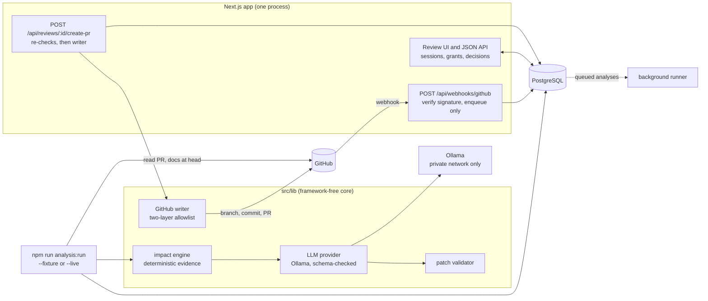

# Architecture

## Intended shape

- Next.js App Router: UI, authenticated dashboard routes and thin Route Handlers.
- Core modules under `src/lib/`: framework-independent business logic.
- GitHub adapter: verifies webhooks, fetches PR metadata/diffs, and later creates branches/PRs.
- Diff analyzer: parses diff metadata and extracts deterministic signals; never executes repository code.
- Impact engine: ranks documentation candidates and attaches evidence.
- LLM provider: interface with Ollama implementation and strict input/output schemas.
- Patch validator: validates allowed paths, patch boundaries and resulting Markdown.
- PostgreSQL: review sessions, candidates, proposals, decisions and idempotency records.
- Worker interface: long-running analysis can be moved out of request lifecycle; don't assume serverless handlers can run indefinitely.

## As built (Phase 06)

What exists and runs today. Dashed edges are not built.

- **Webhooks only enqueue (D-009).** There is no runner, so live analyses come from the CLI (`analysis:run --live`).
- **Writes are off by default** and go only through the writer (docs/13).
- **The reference deployment** (docs/10) puts Postgres and Ollama on an internal network behind a TLS proxy.

## Data flow

1. Verify webhook signature using raw request body.
2. Record an idempotency key and enqueue/dispatch analysis.
3. Fetch bounded metadata and diffs with least-privilege credentials.
4. Parse changed files and deterministic evidence.
5. Select candidates; preserve reasons and evidence references.
6. Optionally ask the configured model for analysis and patch proposals.
7. Validate all model output against schemas and patch policy.
8. Persist proposals for human review.
9. On explicit approval, re-check authorization and source revision before GitHub writes.
10. Create a new documentation branch and pull request; never merge automatically.

## Module boundaries

Keep these concepts independently testable:
- `github/`: external API adapter.
- `diff-analyzer/`: parsing and deterministic signals.
- `impact-engine/`: candidate selection and ranking.
- `llm/`: provider interface, prompts and output validation.
- `patch-validator/`: safe patch rules.
- `review/`: decisions and state transitions.
- `db/`: migrations and repositories.
- `security/`: webhook validation, authz, redaction and path policy.

## Design principles

- Route Handlers are thin: parse, authenticate, validate, call services, map errors.
- Do not let UI components call GitHub or Ollama directly.
- Do not couple the impact engine to Next.js request/response types.
- Avoid adding infrastructure without a measured requirement.

## Implemented so far (Phase 00)

- Next.js 16.4 App Router under `src/app/`. `cacheComponents` is enabled, so `GET` handlers that read no request or runtime data are prerendered at build time.
- `src/app/api/health/route.ts`: static liveness endpoint. It does not check the database or the model.
- `src/lib/schemas.ts`: framework-independent Zod contracts for evidence references, impact candidates, analysis state and its transitions, patch proposals, review decisions (a client input schema and a separate server-built record schema) and the API error envelope.
- `src/lib/env.ts`: lazy, server-only environment validation, in groups (database, webhook secret, GitHub App, migrations), each validated only where it's used.
- `src/lib/db/pool.ts`: lazy, server-only `pg` pool with connection, idle and statement timeouts.

## Implemented so far (Phase 01)

- `POST /api/webhooks/github` (`src/app/api/webhooks/github/route.ts`) is a thin wrapper around `src/lib/github/webhook-handler.ts`. The handler reads at most 1 MiB, verifies the HMAC signature over the raw bytes, then validates headers and payload. Supported `pull_request` actions are `opened`, `synchronize`, `reopened` and `ready_for_review`; drafts are ignored. The handler only queues work: it never fetches from GitHub or runs a model inline.
- `src/lib/db/analyses.ts`: `enqueueAnalysis` upserts the repository and PR and inserts a `queued` analysis keyed on `github:pr:<repoId>:<number>:<headSha>`, all in one transaction. Redeliveries and concurrent duplicates return the existing analysis (D-009).
- **Nothing consumes queued analyses yet (D-009).** Ingestion is a separate service, `ingestPullRequest(reader, ref, { expectedHeadSha? })` in `src/lib/ingest.ts`, run by `npm run ingest`. It fails with `GITHUB_STALE_HEAD` if the PR head or base moves during ingestion, or if the head isn't the expected commit. A future runner must pass the analysis's `head_sha` as `expectedHeadSha`. A runner that connects the queue to ingestion is decided in a later phase.
- `src/lib/github/reader.ts` defines the `GitHubReader` interface: `getPullRequest` and `listFiles` only, no writes (Phase 05 adds a separate `GitHubTreeReader` for the live CLI path). There are two implementations. `octokit-reader.ts` is the live GitHub App reader: its installation token is requested with `pull_requests: read` only, a request hook refuses any non-GET call and adds a 10 s timeout, file listing stops at 300 files, and errors are mapped to safe codes. `fixture-reader.ts` serves `fixtures/github/*.json`.
- `src/lib/diff-analyzer/normalize.ts` validates every file path and parses hunks. Unsafe files are rejected by index. Oversized, binary or malformed patches keep the file but drop the hunks (`patchState`). That includes patch text Postgres can't store and hunk numbers outside the safe-integer range, both marked `malformed`. The result is a `PullRequestSnapshot` (Zod) and is not persisted.
- `src/lib/db/migrate.ts` and `scripts/migrate.ts` form the migration runner (D-007). `migrations/0001_ingestion.sql` creates `repositories`, `pull_requests` and `analyses`.
- `src/lib/log.ts`: structured JSON logs with a closed set of fields.
- Not created yet: `security/`. (Phase 03 added `llm/`, `patches/` and `assist/`, and Phase 04 `review/`; see below.)

## Implemented so far (Phase 02)

- `src/lib/impact-engine/`: the deterministic impact engine (`analyzeImpact`), its rule config, and the evaluation harness. It is pure TypeScript with no framework, database, GitHub or model imports (tested). Details in docs/05.
- `npm run analyze -- --fixture <scenario>` runs the engine on a labelled fixture, and `npm run eval:impact` writes `docs/evaluation/impact-baseline.md`.
- Still not connected end to end (D-009, D-010): nothing fetches documentation from GitHub, results are not persisted, and queued analyses are not processed.

## Implemented so far (Phase 03)

- `src/lib/llm/`: the `LlmProvider` transport interface, `generateStructured` (JSON data in, Zod-validated JSON out, one retry for invalid output), the Ollama transport, and the versioned prompts and output schemas.
- `src/lib/patches/`: the allowed-documentation-path policy, git blob SHA, edit placement and unified-diff rendering, a strict diff applier, and `validatePatch`. Pure string code: no file system, network, GitHub, database or model imports (tested).
- `src/lib/assist/`: `assistImpact` runs the deterministic engine, then asks the model to assess flagged candidates and propose edits, and returns only validated proposals. Also the bounded context builder and evaluation helpers.
- The model gets no tools and no credentials and never chooses a file (D-011). Details in docs/06.
- `npm run propose` and `npm run eval:llm` work on fixtures only. Proposals are not persisted and are never applied.

## Implemented so far (Phase 04)

- **Data layer (`src/lib/review/`, server-only):** `session.ts` (login with a generic error and per-username rate limiting, random session tokens stored as SHA-256 hashes, revocation), `password.ts` (scrypt from `node:crypto`), `queries.ts` (dashboard, analysis and review reads, every one joined through the reviewer's repository grant, with JSONB re-validated on read), `decisions.ts` (one final decision per proposal, in a transaction with a row lock, with the approval binding computed on the server), `store.ts` (saves a fixture pipeline run), `api.ts` (route-handler logic), and `auth.ts` (cookie and current-reviewer helpers for pages).
- **Routes:** `/login`, and in the `(review)` route group `/`, `/analyses/[id]` and `/reviews/[id]`; `GET /api/analyses/[id]`, `GET /api/reviews/[id]` and `PATCH /api/reviews/[id]`. Pages are thin: the session read and data load sit inside a `<Suspense>` boundary (Cache Components), and presentation lives in `src/components/`.
- **Security headers** for every route come from `next.config.ts` (`src/lib/security-headers.ts`). There is no `proxy.ts`. The plan's nonce CSP was dropped because nonces are incompatible with Cache Components' static shell (D-012), and authorization lives in the data layer, not in a proxy.
- **Data source:** `npm run analysis:run -- --fixture <name>` runs the real pipeline on a labelled fixture and saves it under a repository marked `source = 'fixture'` (D-012). Live analyses still need doc fetching and a runner (D-009, D-010).
- **No GitHub writes:** accepting a proposal only records a decision. The documentation PR is Phase 05.

## Implemented so far (Phase 05)

Design and controls: docs/13 and docs/07; D-013.
- **Live analyses (CLI only):** `npm run analysis:run -- --live owner/repo#N --installation <id>`. It ingests the PR with the Phase 01 reader, now with `contents: read` for that one repository. It refuses forks, then reads the allowed docs at the head commit through git trees and blobs (`src/lib/github/docs.ts`, with the byte rules in `doc-bytes.ts`). It runs the pipeline and saves it with `saveAnalysis` (`src/lib/review/store.ts`), which upserts the repository by GitHub id as the webhook does and records the PR's branch names. There is still no runner for queued webhook analyses (D-009).
- **Writer (`src/lib/github/writer.ts`, server-only):** `openGitHubWriter` mints a per-operation token scoped to one repository and returns a `GitHubWriter` with exactly the calls the write needs (read the PR, walk the tree, read the base blob, read and create the docs branch, compare, put the file, list and create PRs, revoke the token). No merge or delete. Two guard layers allow only the binding's exact requests.
- **Publish (`src/lib/review/publish.ts`):** `createDocsPr` runs every write-time check, claims the `github_outputs` row under a lease, then branches, commits and opens the PR, persisting each step so retries resume. PR text comes from `pr-content.ts`.
- **Route:** `POST /api/reviews/[id]/create-pr` (`handleCreatePr` in `src/lib/review/api.ts`). The review page shows a `CreatePrPanel` (`src/components/create-pr-panel.tsx`) for accepted or edited decisions on live data when writes are enabled, or explains why not.
