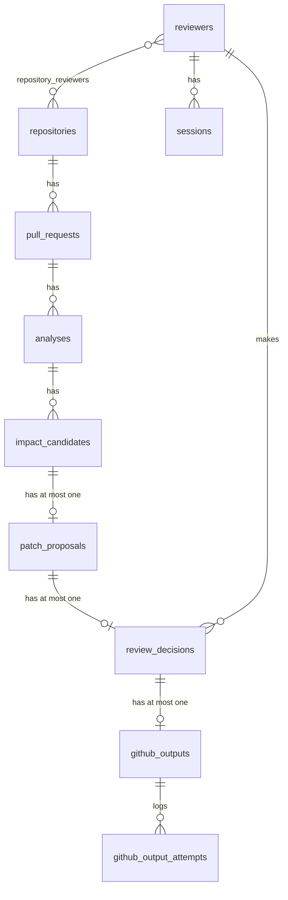

# Data Model

PostgreSQL, accessed with `pg`, with reviewed SQL migrations in `migrations/` (no ORM; D-002, D-007). The migration files are the authoritative schema; this document explains it. Constraints mirror the Zod contracts in `src/lib/schemas.ts`, so invalid state cannot be stored even if application validation is bypassed, and JSONB columns are validated by the application on write and on read.

## Migrations

| File | Adds |
|---|---|
| `0001_ingestion.sql` | `repositories`, `pull_requests`, `analyses` |
| `0002_restrict_app_role.sql` | No tables. Revokes CREATE on schema `public` and TEMPORARY on the database from PUBLIC, and the app role's access to `schema_migrations` and TEMPORARY |
| `0003_review.sql` | `impact_candidates`, `patch_proposals`, `reviewers`, `sessions`, `login_failures`, `repository_reviewers`, `review_decisions`; `source` on `repositories`; result columns on `analyses`; app-role revokes |
| `0004_review_hardening.sql` | Index on `login_failures (attempted_at)`; the app role can no longer update or delete proposals and candidates, and can only revoke sessions |
| `0005_github_writes.sql` | `github_outputs`, `github_output_attempts`; `head_ref` and `base_ref` on `pull_requests`; narrower UPDATE grants |
| `0006_partial_docs.sql` | `docs_partial` on `analyses` |

**Convention.**
- Plain SQL files named `NNNN_short_description.sql`, applied in lexical order. A migration that has been applied anywhere is never edited; changes are new migrations, and rollbacks are forward-only fix migrations.
- Each file runs in one transaction. The runner (`src/lib/db/migrate.ts`, `npm run db:migrate`) records applied files in `schema_migrations` (`name TEXT PRIMARY KEY, applied_at TIMESTAMPTZ`) and skips them. It takes a Postgres advisory lock so concurrent runs serialize, and refuses `.sql` files that don't follow the naming pattern.
- Migrations run as the schema owner (`MIGRATION_DATABASE_URL`). The app connects as `docusync_app` (`DATABASE_URL`). Locally and in CI that role and the `docusync_test` database come from `db/init/01-app-role.sql`; the reference deployment uses `deploy/initdb/` (docs/10). Migrations that restrict the role are guarded by `IF EXISTS (… rolname = 'docusync_app')`, so a deployment with a differently named role must apply equivalent restrictions itself.

## Entity overview

`login_failures` (rate-limit bookkeeping) has no relations.

## Analysis tables

**`repositories`**
- `id` uuid PK; `owner` and `name` (`^[A-Za-z0-9_.-]{1,100}$`); `created_at`, `updated_at`.
- `source` (`github` or `fixture`, default `github`). `github_repo_id` (bigint, unique, positive) and `installation_id` are required exactly when `source = 'github'` and null otherwise, so fixture data never carries made-up GitHub ids (D-012). Fixture repositories are unique by `(owner, name)` (partial unique index).

**`pull_requests`**
- `id` uuid PK; `repository_id` FK (cascade); `github_pr_number` (positive integer); `head_sha`, `base_sha` (40 or 64 lowercase hex); `created_at`.
- `head_ref`, `base_ref` (nullable, 1-255 characters): the source PR's branch names, recorded by live analyses and refreshed on a later live run, also on a row the webhook created. Fixture rows leave them null, and a GitHub write needs both.
- Unique `(repository_id, github_pr_number, head_sha)`: one row per revision of a PR. There is no status column.

**`analyses`**
- `id` uuid PK; `pull_request_id` FK (cascade); `idempotency_key` (unique, 1-200 characters). Webhook analyses use `github:pr:<repoId>:<number>:<headSha>`; fixture runs use `fixture:<scenario>:<random uuid>`, so each fixture run is a new analysis.
- `delivery_id` uuid: the webhook delivery that first created the row (later duplicates are not recorded); null for fixture and CLI runs.
- `status` (`queued`, `running`, `completed`, `failed`, `cancelled`; default `queued`), `started_at`, `completed_at`, `error_code` (upper-snake, `^[A-Z][A-Z0-9_]{0,63}$`), `created_at`.
- CHECK constraints mirror `analysisStateSchema`: `error_code` is set exactly when `status = 'failed'`; `started_at` is null when queued and set when running or completed; `completed_at` is set exactly for terminal statuses; `started_at <= completed_at`.
- Result columns from `0003`: `pr_title` (at most 1,000 characters), `changed_files` (JSONB), `engine_version`, `model_status` (`ok`, `partial`, `unavailable`, `not_configured`), `missing_context` (JSONB). From `0006`: `docs_partial` boolean (default false), true when a live analysis could not read all documentation (truncated tree, or skipped, unreadable or mismatched docs); the reasons are in `missing_context`.

**`impact_candidates`**: one row per flagged document, unique per `(analysis_id, doc_path)`.
- Deterministic fields: `doc_path`, `impact_status` (`likely_affected`, `verify`, `unlikely_affected`), `reason` (1-500 characters), `evidence` (JSONB), `missing_context` (JSONB), `rank_points` (integer 0-10,000; a sum of fixed rule points, **not a probability**), `rules` (JSONB), `engine_version`.
- Model output is stored apart from those fields (D-011): `model_assessment` and `assist_outcome` (nullable JSONB).

**`patch_proposals`**: at most one per candidate (`candidate_id` unique).
- `target_path`, `head_sha`, `base_blob_sha` (the git blob SHA of the document the patch applies to), `base_content` (the document text, at most 200,000 characters, shown side by side and used to re-validate edits), `patch_text` (1-100,000 characters), `rationale` (the model's, 1-2,000 characters), `evidence` (JSONB).
- `validation_status` (`valid`, `invalid`), `validation_issues` (JSONB), `validation_context` (JSONB: related lines, related terms and known links; bounded by `VALIDATION_CONTEXT_LIMITS` where it is built and checked with the same schema before it is saved and when it is read for an edit), and `model` (JSONB metadata).

## Review tables

**`reviewers`**: `username` (unique, `^[a-z0-9][a-z0-9_.-]{1,38}$`), `display_name`, `password_hash` (`scrypt$N$r$p$salt$hash`), `disabled_at`.

**`sessions`**: `token_hash` PK (the SHA-256 of a random 32-byte token; the token itself is never stored), `reviewer_id` FK (cascade), `created_at`, `expires_at` (12 hours after creation), `revoked_at`.

**`login_failures`**: `username` (not trusted to exist), `attempted_at`; failed sign-ins for rate limiting. A sign-in attempt reserves a row (under a per-username lock) before its password is checked and removes it on success; rows older than a day are pruned on each reservation. Indexed on `(username, attempted_at)` and, from `0004`, on `attempted_at` alone (pruning would otherwise scan the whole table on every sign-in; security M-A).

**`repository_reviewers`**: `(repository_id, reviewer_id)` PK, `granted_at`: which reviewer may see and decide on which repository.

**`review_decisions`**: one final decision per proposal (`proposal_id` unique; D-012).
- `decision` (`accepted`, `edited`, `rejected`), `edited_patch` (present exactly when the decision is `edited`), `reviewer_id`, `decided_at`, `created_at`.
- The approval binding, recorded from what the reviewer saw: `repository_id`, `head_sha`, `base_blob_sha` and `patch_sha256` (the SHA-256 of the approved patch text, or of `edited_patch` when edited).
- Every column except `decision` and `edited_patch` is set by the server, never taken from the request body. Before any GitHub write, the stored binding must match the current head SHA, blob SHA and patch hash; otherwise the approval is stale (docs/07 controls 9 and 10). All foreign keys are `ON DELETE RESTRICT`.

## GitHub write tables (`0005`)

**`github_outputs`**: one row per approved decision (`decision_id` unique), the idempotency key for the documentation PR. Foreign keys are `ON DELETE RESTRICT`.
- **Binding, fixed after insert:** `decision_id`, `proposal_id`, `repository_id`; `github_repo_id` and `installation_id` (snapshots); `head_sha`, `base_blob_sha` (40-hex SHA-1 only), `patch_sha256`; `branch` (`docusync/pr-<n>-<12 hex>`); `docs_pr_base_ref` (the documentation PR's base, which is the source PR's head ref); `created_by`; `created_at`.
- **Progress, the only columns the app role may update:** `step` (`pending`, `branch_created`, `committed`, `pr_opened`); `error_code` (the last failure, cleared on success); `commit_sha`, `pr_number`, `pr_url` (must match `https://github.com/<owner>/<repo>/pull/<n>`); `attempts` (0-5); `lease_token`, `lease_until`; `updated_at`.
- Checks: `pr_number` and `pr_url` exist exactly when `step = 'pr_opened'`; `commit_sha` is set from `committed` on; an opened row has no error code.

**`github_output_attempts`**: `output_id`, `reviewer_id`, `attempted_at`: who pressed "Create documentation PR…" each time. Append-only for the app role.

## App-role grants

The default privileges give `docusync_app` SELECT, INSERT, UPDATE and DELETE on every table the owner creates; the migrations then take privileges back. Each is covered by a permission-denied test, and `npm run db:check-grants` verifies the whole set (docs/07, docs/10).

| Table | What the app role cannot do |
|---|---|
| `schema_migrations` | anything (owner-only ledger) |
| `review_decisions` | UPDATE, DELETE, TRUNCATE (append-only audit trail) |
| `reviewers`, `repository_reviewers` | INSERT, UPDATE, DELETE, TRUNCATE (operators manage accounts with the owner role) |
| `sessions` | UPDATE except `revoked_at` (it can only revoke, not extend or un-revoke a session; security L-C); DELETE; TRUNCATE |
| `login_failures` | TRUNCATE |
| `patch_proposals`, `impact_candidates` | UPDATE, DELETE (stored proposals are immutable, so the recorded patch hash always matches what was shown; security L-A) |
| `repositories` | UPDATE except `owner`, `name`, `installation_id`, `updated_at` (what the webhook upsert sets); it cannot repoint `github_repo_id` or `source` |
| `github_outputs` | DELETE, TRUNCATE; UPDATE except the progress columns |
| `github_output_attempts` | UPDATE, DELETE, TRUNCATE |
| database, schema | TEMPORARY on the database; CREATE on schema `public` |

## Invariants

- Access tokens, private keys and webhook secrets are never stored in application tables.
- Valid state transitions are enforced in service code and, where practical, by constraints.
- All queries use parameterized SQL, and JSONB is validated on read and on write.
- A write operation binds approval to the exact proposal and source revision.
- No retention or deletion policy is implemented. One must be defined before a production deployment, because the tables hold document text, patches and reviewer activity.
